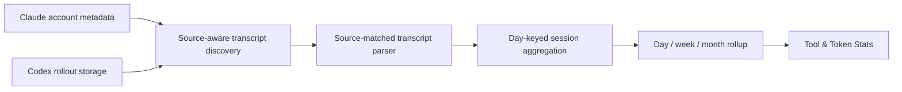
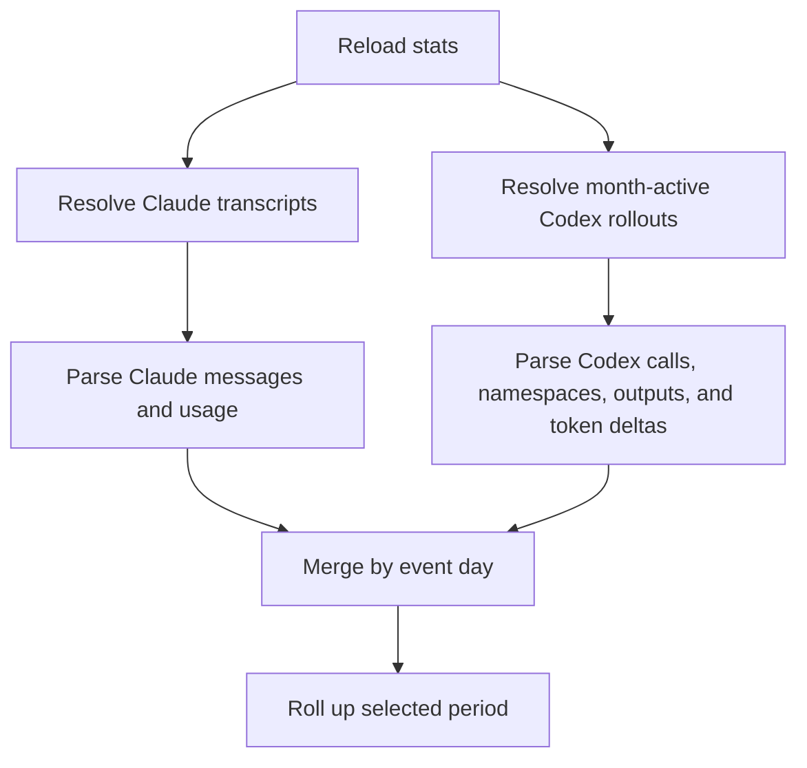
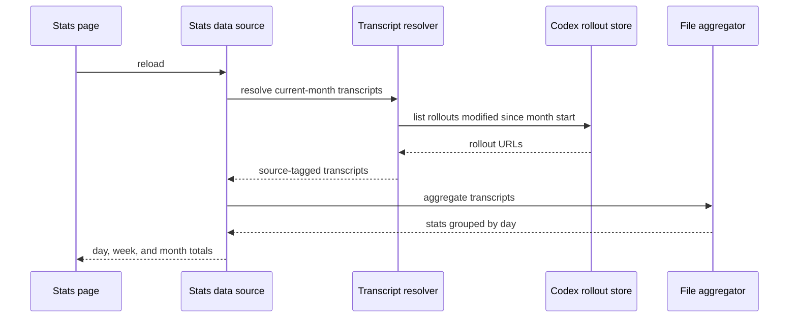

# Codex Tool and Token Stats

## Description

The Tool & Token Stats page currently aggregates Claude transcripts only, even though
Codex sessions are already available elsewhere in the app. Extend the stats pipeline so
Codex rollout files contribute built-in tool calls, MCP calls, MCP result volume, and
token/cache totals to the same day, week, and month views without changing the existing
Claude results.

## Input / Output

|   | Detail |
|---|--------|
| Input | Claude session transcripts resolved from configured accounts and Codex rollout JSONL files under the local Codex sessions directory whose files were active during the current reporting month. Codex inputs include response items, MCP namespaces, tool results, timestamps, and cumulative token-count events. |
| Output | Day-keyed additive session statistics consumed transiently by the Tool & Token Stats data source and rolled up into the existing day, week, and month views. |

## User Stories

### Story 1 — Include Codex transcripts

As a user of both Claude Code and Codex, I want the Tool & Token Stats page to include
both products so that the totals describe my complete local coding activity.

Acceptance criteria:

- A Codex rollout file active on or after the reporting month's start contributes its timestamped events to the applicable day, week, and month totals.
- Claude session discovery and aggregation continue to produce the same results as before this change.
- A transcript is parsed with the schema that matches its source; a Codex rollout is never interpreted as a Claude transcript.
- A missing or unreadable Codex sessions directory contributes zero stats and does not prevent Claude stats from loading.

### Story 2 — Report Codex token usage

As a user, I want Codex input, output, cache-write, and cache-read usage displayed in the
existing token breakdown so that Codex rows no longer remain at zero.

Acceptance criteria:

- Consecutive cumulative Codex token-count events contribute only their non-negative deltas, so earlier turns are not counted repeatedly.
- Cached input and cache-write input are separated from uncached input; their sum with uncached input equals the source event's total input delta.
- Output usage includes the source event's full output count; reasoning output is not added a second time when it is already included in output.
- A token-count event with no usage payload contributes zero.
- If cumulative counters decrease, the event contributes zero for the decreased field rather than producing negative totals.
- Token deltas are attributed to the calendar day of the token-count event.

### Story 3 — Report Codex MCP activity

As a user, I want Codex MCP calls grouped by server and tool with returned payload volume
so that the MCP section is useful for both supported products.

Acceptance criteria:

- A Codex function call whose namespace identifies an MCP server increments that server and tool exactly once.
- A Codex app `exec` wrapper containing a concrete nested MCP tool invocation increments the nested server and tool instead of the outer wrapper.
- A matching Codex function-call output contributes its UTF-8 result size to the invoked MCP server and tool.
- Codex function calls without an MCP namespace remain in the built-in tool totals and are not duplicated in MCP totals.
- A result without a matching call identifier contributes no MCP payload volume and does not fail aggregation.

### Story 4 — Deliver stats to aggregate and individual-session views

As a user, I want stats to appear reliably in both the period Stats page and each
agent/subagent log view, without an unexplained all-zero wait state.

Acceptance criteria:

- The Stats page displays an explicit loading state until its first aggregate is ready instead of presenting initial zero values as final results.
- Stats calculation begins when the main view appears, is shared with the Stats page, and is not restarted while an existing calculation is in flight.
- Reopening the Stats page within one minute reuses the recently loaded result and its per-file cache.
- A Codex parent or child log includes token-count events in its internal stats calculation without rendering those stats-only events as transcript messages.
- A session containing token usage but no tool calls is still recognized as having inline stats.
- Claude bare-child transcript discovery indexes each project directory once per calculation rather than reading every full transcript once per parent session.

## Connects To

| Direction | Component | Relationship |
|-----------|-----------|--------------|
| Upstream | Claude account usage metadata | Continues to resolve Claude session and subagent transcript locations. |
| Upstream | Codex rollout storage | Supplies month-active rollout files and their source-specific JSONL schema. |
| Internal | Shared log-message and session-stat aggregation | Receives source-correct parsed messages and keeps the existing additive counting rules. |
| Downstream | Tool & Token Stats data source | Receives one combined day-keyed map for period rollup. |
| Downstream | Existing stats views | Display combined tools, MCP calls, payload estimates, tokens, and cache-hit rate without UI changes. |

## Technical Requirements

- Preserve source identity alongside every resolved transcript until parsing is complete.
- Discover Codex rollouts through the existing Codex storage boundary rather than through configured Claude accounts.
- Decode the Codex MCP namespace independently from the tool name and normalize the pair into the shared MCP representation.
- Derive token increments from cumulative totals using a previous-snapshot comparison per rollout file.
- Keep per-file modification-time caching in place for both transcript sources.
- The aggregated stats page includes Codex globally because Codex is a local product source rather than a configured Claude account; existing account filtering remains unchanged and is outside this spec.
- Recover concrete nested MCP tool names recorded in Codex app orchestration source; dynamically selected tools that are absent from the rollout remain outside the observable stats boundary.
- Keep stats-only token messages out of the visible transcript while retaining them in the message collection used by `SessionStatsAggregator`.
- Publish loading state and retain one production stats data source across main-page and Stats-page navigation.
- Inspect only a bounded JSONL prefix when identifying bare child relationships; load the full transcript only after a parent match.

## Diagrams

### Connection

### Flow

### Sequence

## Test Plan

### Unit Tests — Codex rollout parsing

- When two cumulative token-count events increase input, cache, and output counters, parsing emits only the two deltas and their combined totals equal the final cumulative snapshot.
- When cached and cache-write input are subsets of total input, parsing reports the remainder as uncached input and reports each cache category separately.
- When an MCP function call contains a namespace and a matching output, aggregation groups the call by server and tool and records the output's UTF-8 byte size.
- When a Codex app exec wrapper invokes one concrete nested MCP tool and returns an output, aggregation counts the nested MCP tool and attributes the output size to it.
- When a built-in Codex function call has no MCP namespace, aggregation increments only the built-in tool count.
- When a token counter decreases or its payload is absent, aggregation adds no negative usage and continues.

### Integration Tests — Stats pipeline

- When one Claude transcript and one Codex rollout are supplied together, source-matched parsing returns the sum of both files without cross-format parsing.
- When Codex storage returns a rollout active during the reporting month, transcript discovery marks it as Codex and includes it alongside Claude transcripts.
- When Codex storage returns no rollouts, Claude transcript discovery and aggregation remain unchanged.
- When the stats data source finishes an asynchronous reload, its observable day total changes from zero to the computed value and loading ends.
- When a session has token usage but no tools, the inline stats panel reports that stats are available.
- When multiple candidate bare-child files exist, the stats locator returns only files whose spawned-by parent matches and reuses its directory index.

## Definition of Done

- [x] Codex month-active rollout files enter the stats pipeline with source identity preserved.
- [x] Codex cumulative token usage produces non-zero, non-duplicated token and cache totals.
- [x] Codex MCP namespaces and result payload sizes produce grouped MCP stats.
- [x] Claude aggregation behavior remains covered by the existing test suite.
- [x] Focused Codex regression tests and the full package test suite pass.
- [x] Aggregate stats preload through a shared observable data source and show a loading state while work is active.
- [x] Individual Codex agent/subagent views include token and nested MCP statistics.
- [x] Token-only sessions expose their inline stats panel.
- [x] Real-session discovery avoids repeated full-transcript scans and produces non-zero live totals.
